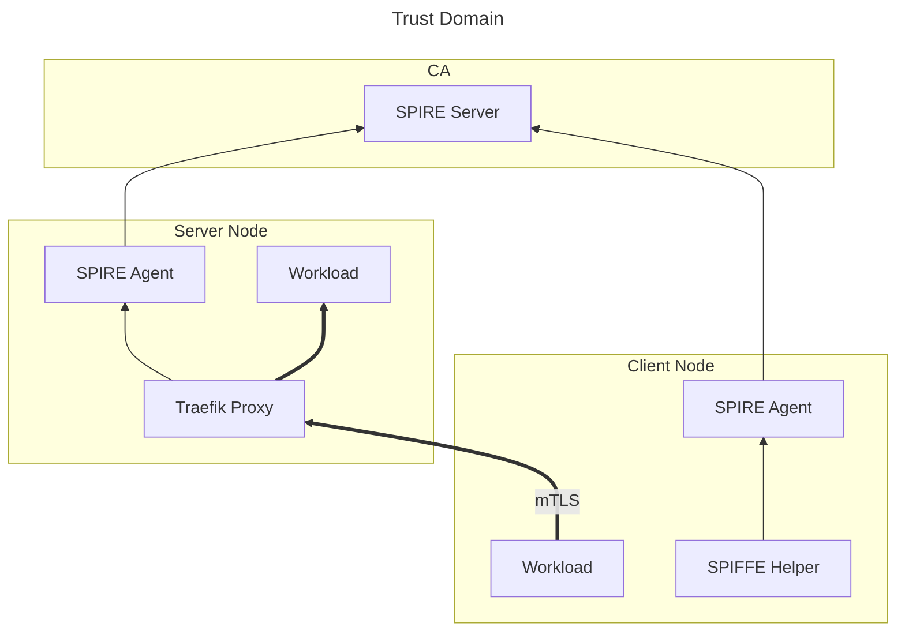

# SPIFFE mTLS PoC

## Architecture

- CA
  - HashiCorp Vault (Optional)
  - SPIRE Server
- Server Node
  - SPIRE Agent
  - Traefik Proxy
  - Workload
- Client Node
  - SPIRE Agent
  - SPIFFE Helper
  - Workload



## Setup

To run CA:

```sh
docker compose up --detach
```

To run server:

```sh
docker compose --profile server-node up --detach
```

To run client:

```sh
docker compose --profile client-node up --detach
```
